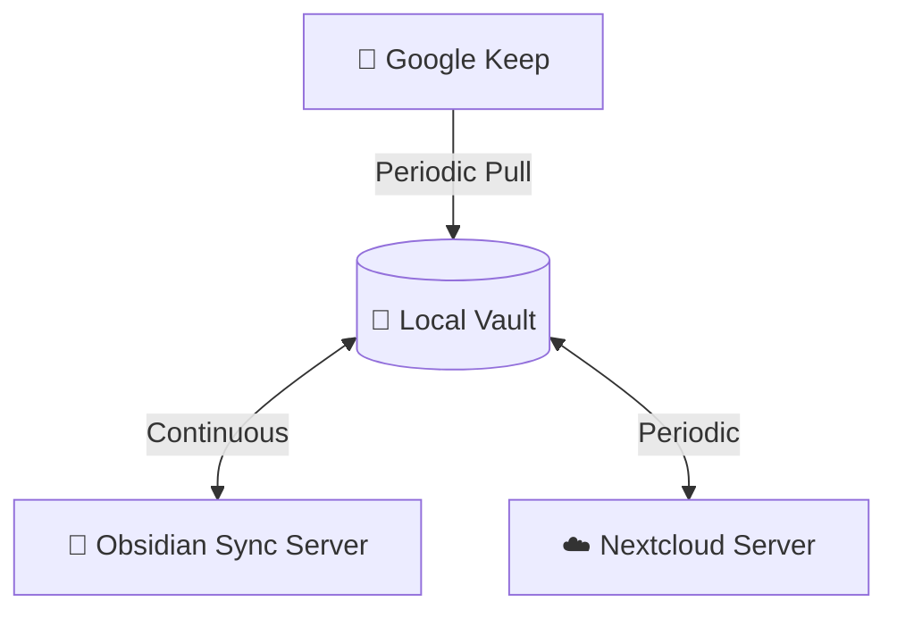

# Obsidian Sync Server

A headless sync hub running as a Docker container that integrates:

- 💎 **Obsidian Sync** (official `obsidian-headless` client)
- ☁️ **Nextcloud Sync** (`nextcloudcmd` client)
- 📝 **Google Keep** (pulling notes via `gkeepapi`)

## System Architecture

The server acts as a central hub (the "Local Vault") mediating data flow between three separate platforms.

## Features

### 📝 Google Keep Integration
- **One-way Pull**: Imports notes matching required tags as Markdown files into a designated vault folder.
- **Advanced Tag Extraction & AI Integration**: Extracts inline hashtags and `Labels:` lines directly from the Keep note body. This is especially powerful for notes saved via AI assistants like Google Gemini. While Gemini cannot natively apply Keep labels, it automatically attaches a URL annotation to the note. You can prompt Gemini to include text tags (e.g., `#idea`) in the note body. The syncer uses the annotation to identify these notes, extracts your inline tags, writes them back to the Google Keep note as native labels, and includes them in your Obsidian Markdown frontmatter.
- **Smart Tag Matching**: Case-insensitive matching of required, ignored, and extracted tags.
- **Sync State Tracking**: Optionally applies a configured label (e.g., `synced`) to the original Keep note to prevent re-importing the same note twice.
- **Flexible Authentication**: Supports standard Google credentials and master token flow.

### ☁️ Nextcloud Synchronization
- **Bidirectional Sync**: Periodically synchronizes your local vault with your Nextcloud instance.
- **Conflict Management**: Automatically prioritizes Obsidian as the source of truth, cleaning up Nextcloud conflict files (`_conflict-*`) to prevent sync loops.

### 💎 Obsidian Sync Integration
- **Real-time Sync**: Runs the official `obsidian-headless` client continuously to ensure near-instant sync with your other devices.
- **Process Management**: Monitors and automatically restarts the background client if it crashes.

## The Sync Process

The server runs in daemon mode and orchestrates synchronization tasks for each of your configured "sync sets" (vaults). 

**Continuous Sync:**

*   **Obsidian Sync:** The official `obsidian-headless` client is launched as a persistent background process. It runs continuously, observing your vault directory and pushing/pulling changes in real-time with the Obsidian Sync servers.

**Periodic Sync (Every 5 minutes by default):**

Every sync interval, the main Python daemon wakes up and performs the following sequence for each vault:

1.  **Keep Alive:** It verifies the Obsidian Sync background process is still running and healthy, restarting it if necessary.
2.  **Google Keep Pull:** It connects to Google Keep via `gkeepapi`. It searches for active notes matching your configured `tags` (while ignoring any `ignore_tags`). It converts matching notes to Markdown, enriches them with frontmatter, and saves them into the designated `target_folder`. Finally, it applies the `mark_synced_tag` to the Keep note.
3.  **Nextcloud Sync:** It invokes `nextcloudcmd` to synchronize your local vault directory with your remote Nextcloud server. This ensures all your Obsidian notes (and your newly imported Keep notes) are backed up to Nextcloud.

!!! info "Conflict Resolution"
    In this architecture, Obsidian is considered the authoritative source of truth. To prevent sync loops and duplicate files, any conflict files generated by Nextcloud (`_conflict-*`) are automatically deleted during the Nextcloud sync phase. Obsidian's own conflict resolution strategy will handle any underlying discrepancies.

## Sync Cycle Sequence

The following diagram shows the exact ordering of operations within a single periodic sync cycle, and how it interacts with the continuously running Obsidian Sync process.

```mermaid
sequenceDiagram
    participant Daemon as Python Daemon
    participant OB as Obsidian Sync (background)
    participant FS as Local Vault (filesystem)
    participant GK as Google Keep API
    participant NC as Nextcloud Server

    Note over OB,FS: Obsidian Sync runs continuously,<br/>watching the vault directory

    loop Every 5 minutes
        Daemon->>OB: Health check (restart if crashed)

        rect rgb(60, 60, 90)
            Note over Daemon,GK: Phase 1 — Google Keep Pull
            Daemon->>GK: Authenticate (with retry)
            GK-->>Daemon: Session
            Daemon->>GK: Fetch all notes
            GK-->>Daemon: Notes list
            Daemon->>Daemon: Filter by tags, extract inline tags
            Daemon->>FS: Atomic write (.tmp → rename)
            Daemon->>GK: Add synced tag to note
            Daemon->>GK: Push label changes (with retry)
        end

        rect rgb(60, 90, 60)
            Note over Daemon,NC: Phase 2 — Nextcloud Sync
            Daemon->>NC: nextcloudcmd (with retry, creds via env)
            NC-->>FS: Bidirectional sync
            Daemon->>FS: Delete conflict files (log content first)
        end

        Daemon->>FS: Write healthcheck timestamp

        Note over OB,FS: Obsidian Sync picks up<br/>new/changed files automatically
    end
```

## Design Decisions

### One-Way Archive Semantics (Google Keep)

The sync from Google Keep is strictly **one-way pull**. Deleting a note in Google Keep does **not** delete the corresponding file from the local vault. Your vault acts as a permanent archive of imported notes. This is intentional — once a note is in your vault, it is yours to keep, reorganize, or delete manually.

### Obsidian as Source of Truth

When conflicts arise between Obsidian Sync and Nextcloud, **Obsidian wins**. Nextcloud conflict files (`*_conflict-*`) are automatically deleted. Before deletion, the syncer logs a preview of the conflicting content so that data is not silently lost.

### Atomic File Writes

When saving a Google Keep note to disk, the syncer writes to a temporary file (`.tmp`) and then atomically renames it to the final path. This prevents Obsidian Sync or Nextcloud from reading a half-written file.

### Crash Recovery

The `mark_synced_tag` is applied to a Keep note *after* the file is written but *before* it is pushed back to Keep. If the process crashes between writing the file and pushing the tag:

- **Worst case**: the note is imported again on the next cycle, overwriting the existing file with identical content.
- **No data loss** occurs because the file was already written atomically.

If the process crashes after pushing the tag but before Nextcloud sync, the file will simply be picked up by Nextcloud on the next cycle.

### Retry Strategy

Network operations (Keep authentication, Keep sync push, Nextcloud sync) use **exponential back-off** with up to 3 retry attempts. Only transient errors (network timeouts, connection errors) are retried. Permanent errors (bad credentials) fail immediately.

### Container Health Monitoring

The daemon writes a timestamp to `/tmp/last_sync` after each successful sync cycle. The Docker `HEALTHCHECK` verifies this timestamp is less than 10 minutes old. If three consecutive checks fail, Docker marks the container as `unhealthy`, which is visible via `docker compose ps` and can trigger restart policies.

