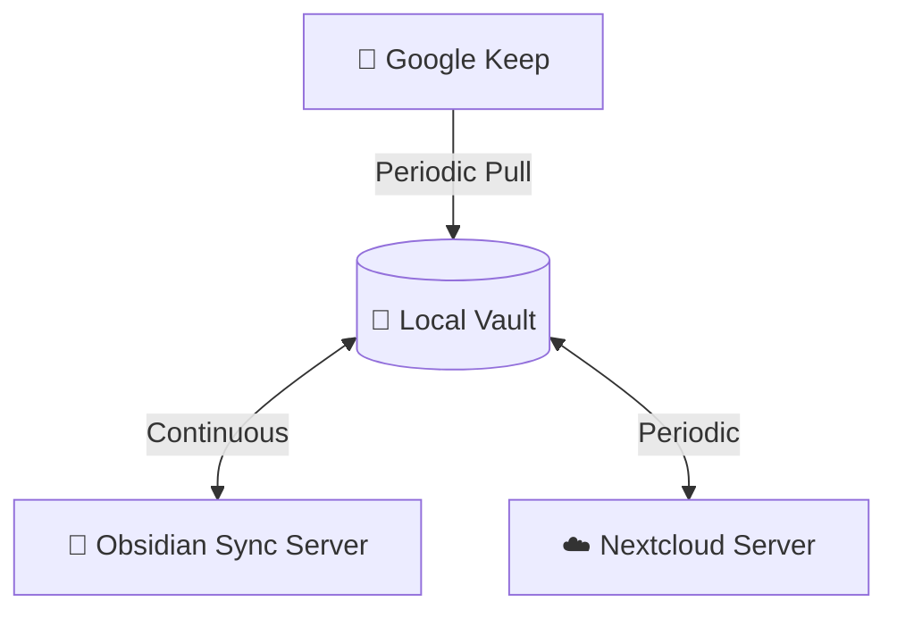

# Obsidian Sync Server

A headless sync hub running as a Docker container that integrates:

- 💎 **Obsidian Sync** (official `obsidian-headless` client)
- ☁️ **Nextcloud Sync** (`nextcloudcmd` client)
- 📝 **Google Keep** (pulling notes via `gkeepapi`)

## System Architecture

The server acts as a central hub (the "Local Vault") mediating data flow between three separate platforms.

## Features

### 📝 Google Keep Integration
- **One-way Pull**: Imports notes matching required tags as Markdown files into a designated vault folder.
- **Advanced Tag Extraction & AI Integration**: Extracts inline hashtags and `Labels:` lines directly from the Keep note body. This is especially powerful for notes saved via AI assistants like Google Gemini. While Gemini cannot natively apply Keep labels, it automatically attaches a URL annotation to the note. You can prompt Gemini to include text tags (e.g., `#idea`) in the note body. The syncer uses the annotation to identify these notes, extracts your inline tags, writes them back to the Google Keep note as native labels, and includes them in your Obsidian Markdown frontmatter.
- **Smart Tag Matching**: Case-insensitive matching of required, ignored, and extracted tags.
- **Sync State Tracking**: Optionally applies a configured label (e.g., `synced`) to the original Keep note to prevent re-importing the same note twice.
- **Flexible Authentication**: Supports standard Google credentials and master token flow.

### ☁️ Nextcloud Synchronization
- **Bidirectional Sync**: Periodically synchronizes your local vault with your Nextcloud instance.
- **Conflict Management**: Automatically prioritizes Obsidian as the source of truth, cleaning up Nextcloud conflict files (`_conflict-*`) to prevent sync loops.

### 💎 Obsidian Sync Integration
- **Real-time Sync**: Runs the official `obsidian-headless` client continuously to ensure near-instant sync with your other devices.
- **Process Management**: Monitors and automatically restarts the background client if it crashes.

## The Sync Process

The server runs in daemon mode and orchestrates synchronization tasks for each of your configured "sync sets" (vaults). 

**Continuous Sync:**

*   **Obsidian Sync:** The official `obsidian-headless` client is launched as a persistent background process. It runs continuously, observing your vault directory and pushing/pulling changes in real-time with the Obsidian Sync servers.

**Periodic Sync (Every 5 minutes by default):**

Every sync interval, the main Python daemon wakes up and performs the following sequence for each vault:

1.  **Keep Alive:** It verifies the Obsidian Sync background process is still running and healthy, restarting it if necessary.
2.  **Google Keep Pull:** It connects to Google Keep via `gkeepapi`. It searches for active notes matching your configured `tags` (while ignoring any `ignore_tags`). It converts matching notes to Markdown, enriches them with frontmatter, and saves them into the designated `target_folder`. Finally, it applies the `mark_synced_tag` to the Keep note.
3.  **Nextcloud Sync:** It invokes `nextcloudcmd` to synchronize your local vault directory with your remote Nextcloud server. This ensures all your Obsidian notes (and your newly imported Keep notes) are backed up to Nextcloud.

!!! info "Conflict Resolution"
    In this architecture, Obsidian is considered the authoritative source of truth. To prevent sync loops and duplicate files, any conflict files generated by Nextcloud (`_conflict-*`) are automatically deleted during the Nextcloud sync phase. Obsidian's own conflict resolution strategy will handle any underlying discrepancies.
